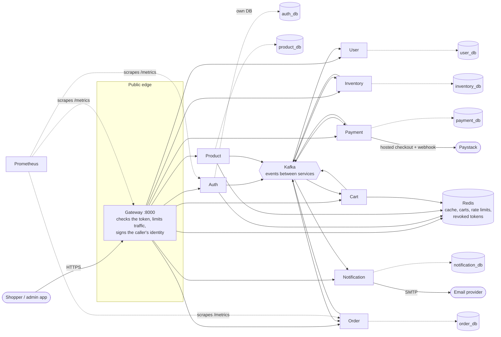
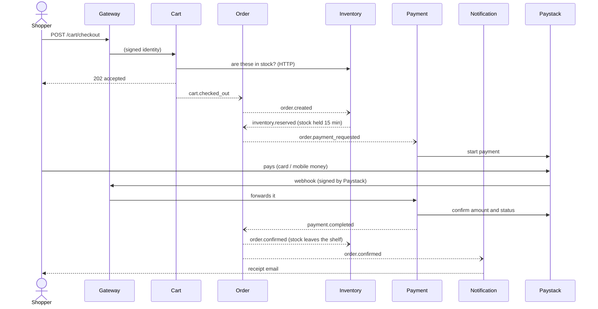
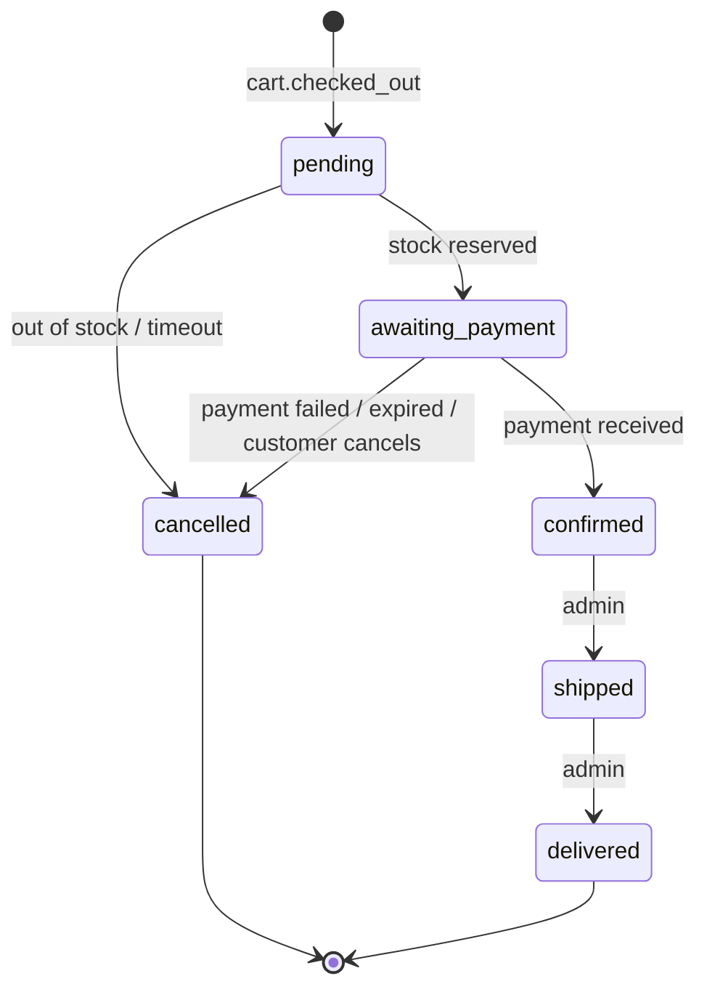

# Architecture

An online shop built as nine small services plus a gateway. Each service owns one job and its own database;
they cooperate by sending events through Kafka. This page explains the shape of the system, how a purchase
travels through it, and why it is built this way. The reasoning behind individual choices lives in
[docs/adr/](adr/).

## The big picture

Two ways services talk, used for different jobs:

| | Used for | Examples |
|---|---|---|
| **HTTP, through the gateway** | A person is waiting for the answer | Log in, browse, add to cart, place an order |
| **Events on Kafka** | Something happened that others should react to | `order.created`, `payment.completed`, `user.registered` |

The only direct service-to-service HTTP calls are the cart reading prices, stock and the delivery address while a
shopper waits. Everything else is events, so a slow or crashed service never blocks another one: its messages wait.

## Who owns what

| Service | Owns | Stores in |
|---|---|---|
| Auth | accounts, passwords, token issuing | Postgres, Redis (revoked tokens, login lockouts) |
| User | profiles, addresses | Postgres |
| Product | catalogue, prices | Postgres, Redis (cache) |
| Inventory | stock levels, reservations | Postgres |
| Cart | baskets | Redis only (30 days, no database) |
| Order | orders and their status history | Postgres |
| Payment | payments, refunds (Paystack) | Postgres |
| Notification | emails and their delivery state | Postgres |

No service reads another's tables. If a service needs another's data it asks over HTTP or keeps its own copy
fed by events (the cart keeps a copy of product prices that way).

## A purchase, step by step

`--)` is an asynchronous event; solid arrows are requests someone waits on. If stock is short, payment fails or
nobody pays in time, the order is cancelled and `order.cancelled` makes the inventory release the stock.

### The order's life

The order service is the only authority on this. Other services report facts (stock reserved, payment received)
and the order decides what that means.

## Making it dependable

Networks drop messages and services crash mid-sentence. These patterns keep the shop correct anyway:

| Problem | Pattern | Where |
|---|---|---|
| "Saved to the database but the event was never sent" | **Transactional outbox**: the event is written in the same transaction as the change, and sent afterwards | auth, product, inventory, order, payment |
| The same event delivered twice | **Idempotent consumers**: each event id is recorded with the work it caused, so a repeat does nothing | every consumer |
| A message that can never be handled | **Retries, then a dead-letter topic** (`<topic>.dlq`), so it cannot block the queue | every consumer |
| Two shoppers buying the last item | **Row locks** in a fixed order, a check under the lock, and database `CHECK` constraints as a last line of defence | inventory |
| A retried checkout creating two orders | The checkout id comes from the cart's contents, and the order service accepts each id once | cart, order |
| A dead service slowing everything | **Timeouts, one retry for reads, a circuit breaker** | gateway |
| Money moving twice | A payment per order (unique), a fresh reference per attempt, amounts confirmed with the provider | payment |
| Redis down | Rate limiting, the cache and revocation checks **fail open** (see [ADR 0008](adr/0008-fail-open-when-redis-is-down.md)) | gateway, product, auth |

## Security

* **Only the gateway is public.** Services share a private network; the dev override opens ports for debugging only.
* **Login tokens (JWT, RS256).** Auth signs with a private key; the gateway holds only the public key, so a stolen
  gateway cannot mint admin tokens ([ADR 0006](adr/0006-asymmetric-jwt-signing.md)).
* **Signed identity between services.** The gateway signs "who is calling" for each request and every service
  discards identities without a valid signature ([ADR 0005](adr/0005-signed-identity-between-services.md)).
* **Guessing and abuse.** Per-IP limits on login and sign-up at the gateway; five failed logins lock an email for
  15 minutes; logging out revokes the access token immediately.
* **Safe to start only when safe.** With `ENVIRONMENT=production`, every service refuses to start while any unsafe
  default (weak secrets, the fake payment provider, console-only email, HS256 tokens...) is still in place.
* **Webhooks** are accepted without a login but only with a valid HMAC signature, and are re-checked with Paystack.

## Seeing what is happening

* `/metrics` on every service (request rate, errors, latency, events handled and dead-lettered), collected by
  **Prometheus** and shown in **Grafana** (a "Shop overview" dashboard is provisioned automatically).
* **One correlation id follows a checkout across every service**: it is created at the gateway, travels in HTTP headers
  and inside every event, and consumers log under it. Search the logs for one id to see the whole story.
* Structured JSON logs; `/health` (alive) and `/ready` (dependencies reachable) on every service;
  `GET /health/services` on the gateway checks them all.

## Ports (development)

| | Port | | Port |
|---|---|---|---|
| Gateway (the only public one) | 8000 | Payment | 8007 |
| Auth | 8001 | Notification | 8008 |
| User | 8002 | Kafka UI | 8080 |
| Product | 8003 | Mailpit (see the emails) | 8025 |
| Inventory | 8004 | Prometheus | 9090 |
| Cart | 8005 | Grafana | 3001 |
| Order | 8006 | Postgres (Docker) | `POSTGRES_HOST_PORT`, 5432 by default |

## What is deliberately not here

No SMS or WhatsApp, partial refunds, a customer-facing "pay now" page (a frontend redirects to the payment link),
unsubscribe preferences, distributed tracing with OpenTelemetry (the correlation id covers most of it), or
Kubernetes manifests. Each is a natural next step, and none changes the structure above.
